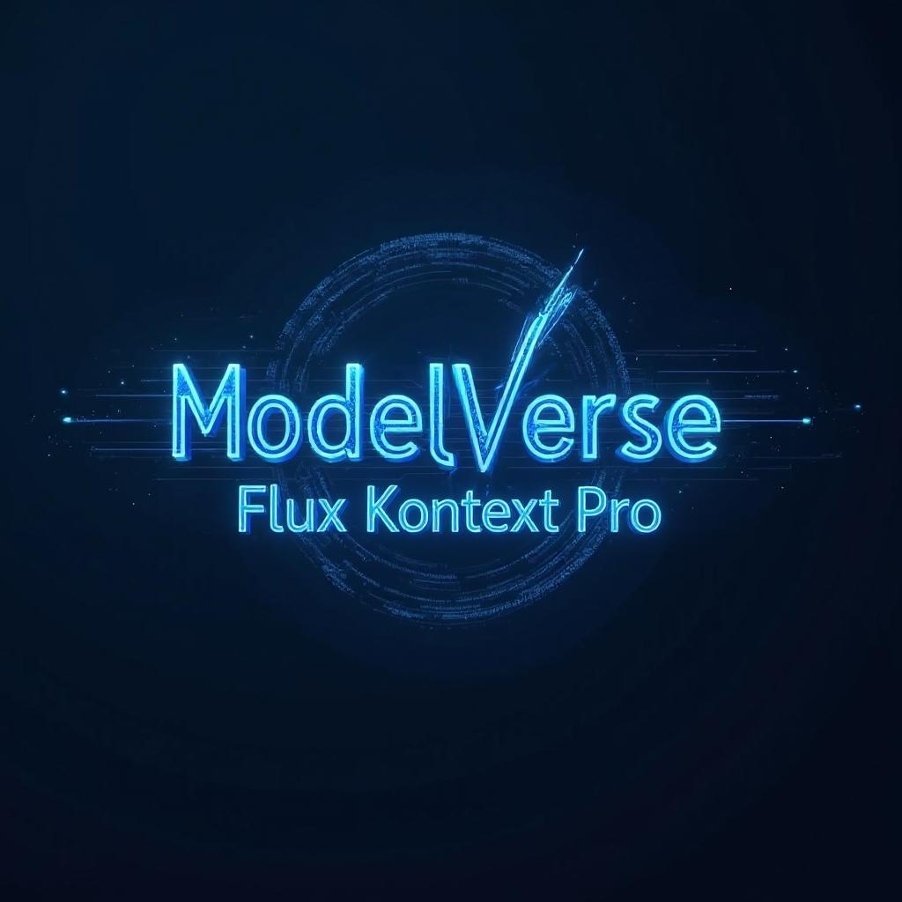
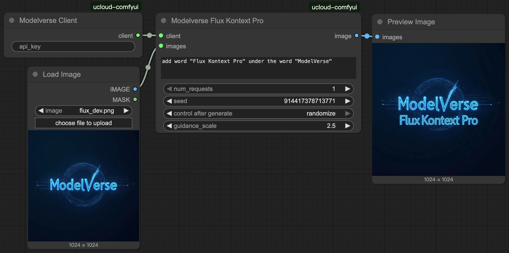
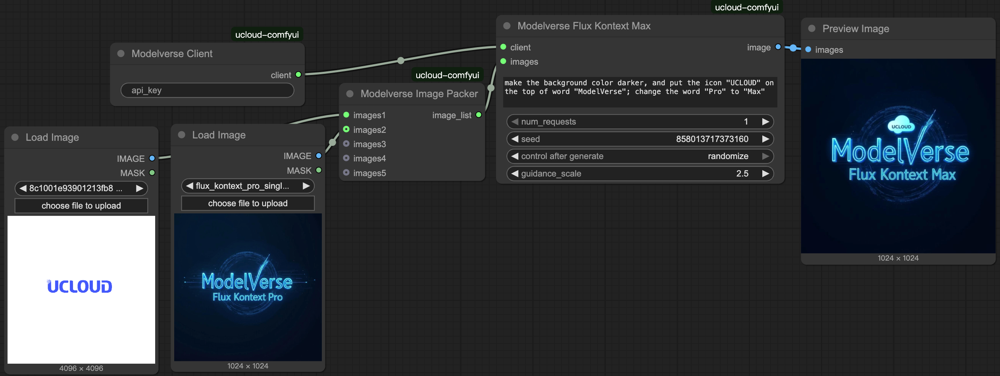

# UCloud ModelVerse API for ComfyUI

This plugin provides seamless integration with UCloud's ModelVerse API, enabling you to use powerful AI models directly within ComfyUI for image generation and editing tasks.

## Quick Start

### Installation

1. **Install via Custom Node Manager** (Recommended)
   - Open ComfyUI
   - Go to **Manager** → **Custom Nodes Manager**
   - Search for "ComfyUl-UCloud"
   - Click **Install**
   - Restart ComfyUI

2. **Configure API Key**
   
   - Get your API key: [Console En](https://astraflow.ucloud.cn/modelverse/api-keys), [Console Zh](https://astraflow.ucloud.cn/modelverse/api-keys)
   - Add your UCloud ModelVerse API key in the `Modelverse Secret Client` node
   - Or Alternatively, create a `config.ini` file with `MODELVERSE_API_KEY=your_api_key`

### Basic Usage

1. Add a `Modelverse Secret Client` node to your workflow
2. Choose your desired model from the supported models below
3. Connect the appropriate input/output nodes
4. Run your workflow

## Supported Models

Our plugin supports the following models, each optimized for specific use cases.

### Image Generation

- **Doubao Seedream** - doubao-seedream-5-5-261028 / 5-0-pro-260628-global / 5-0-260128 / 4-5-251128
- **Flux 2 Pro** - Black Forest Labs' latest text-to-image model
- **Flux Pro 1.1** - Black Forest Labs' high-quality text-to-image model
- **Flux Kontext Pro / Text2Image / Multi-inputs** - Image editing and text-to-image
- **GPT Image 2** - gpt-image-2 / 1.5 / 2.5-flare / 2.5-sunburst / 2.6-flare / 2.6-sunburst
- **GPT Image 1 / GPT Image 1 Edit** - OpenAI's text-to-image and editing models
- **Gemini 3 Pro Image** - Google's professional asset production with search grounding
- **Gemini Flash Image** - gemini-3.1-flash-image / gemini-2.5-flash-image
- **Gemini Nano Banana 2.1** - Google's fast image generation model
- **Qwen Image 3.0** - qwen-image-3.0 / qwen-image-3.0-pro
- **Wan 2.7 Image** - wan2.7-image / wan2.7-image-pro
- **MiniMax H3 Image** - MiniMax image generation
- **Grok Imagine** - grok-imagine-image / grok-imagine-image-quality
- **Step1X-Edit** - Precision local editing and inpainting

### Video Generation

- **Kling V4** - kling-v4 / kling-v4-flash
- **Kling Video O1** - Kling's video model with reference inputs
- **Kling V2.6 / V3 / V3 Omni** - Text/image-to-video, motion control and multimodal reference
- **Wan 3.0** - Wan's latest video generation model
- **Wan 2.7 T2V / I2V / R2V / Video Edit** - Text, image, reference-to-video and video editing
- **Wan-AI 2.2 T2V / I2V** - Text/image-to-video generation
- **Doubao Seedance 2.5 / 2.0** - Text/image-to-video with audio generation
- **MiniMax H3** - MiniMax-H3 / MiniMax-H3-Max / minimax-h3-lite (public image URLs only)
- **Veo 3.1** - Google's video generation (veo-3.1-generate-001 / fast)
- **Vidu** - Text2Video, Img2Video, Reference2Video, StartEnd2Video, Extend, Lip Sync, MV
- **Pixverse V6** - Pixverse video generation
- **Grok Imagine Video** - Grok video generation
- **HappyHorse 1.0** - T2V / I2V / R2V / Video Edit

### Audio Generation

- **Qwen TTS** - qwen3-tts-flash / qwen-audio-3.1-tts-flash / qwen-audio-3.1-tts-plus
- **Seed Audio 1.0** - ByteDance speech synthesis
- **MiniMax Speech** - speech-2.8-hd / speech-2.8-turbo / speech-2.6-hd

### 3D Generation

- **Tripo 3D** - tripo-h3.1 / tripo-p2 (text, image or multiview to GLB/FBX)

Note: (Multi-inputs) models use the same node interface as their single-input counterparts. Check the example workflows below for implementation details.

## Example Workflows

Build your own workflow with Modelverse nodes. You can check the following images, drag them into ComfyUI GUI and autoload example workflows.

| Flux Kontext Pro | Flux Kontext Max (Multi-inputs) |
|:-:|:-:|
|  |  |

In case the above images does not work for you, check the screenshot below:

Single image editting with Flux Kontext Pro

Multi image editting with Flux Kontext Max

    